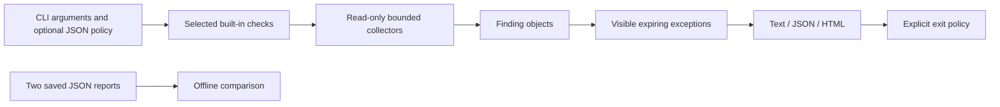

# Architecture and scope

LinScope is a local, read-only, standard-library Python CLI. It has no daemon,
remote agent, web server, external API, or automatic remediation path.

## Components

* `core.py`: immutable findings, command results, bounded file/glob collectors,
  and fixed-argument subprocess execution. Commands use a trusted system PATH,
  a controlled locale, timeouts, and bounded collected output. Fixture contexts
  cannot accidentally execute live commands.
* `checks/`: fourteen independent modules; each `run(context)` returns findings.
  Checks never run shell strings, invoke sudo, execute discovered tasks, download
  package metadata, or change host settings.
* `registry.py`: explicit category registry; policy cannot inject Python modules
  or commands.
* `cli.py`: scope/profile selection, collector isolation, report persistence,
  comparison, and threshold exit handling.
* `policy.py`: strict declarative JSON parsing and expiry annotation.
* `reporting.py`: shared report validation, escaped standalone HTML, safe text,
  JSON serialization, and conservative snapshot differences.

Read-only means no host security configuration is changed. Explicit report
outputs and temporary subprocess capture files are filesystem writes. Reports
are exclusively created with mode 0600; existing paths/symlinks are not replaced.
No private-key contents, password hashes, raw environment files, or application
logs are collected. Reports still contain potentially sensitive inventory.

## Confidence and coverage

Status and severity are independent. UNKNOWN is an evidence failure, while INFO
is inventory with no pass/fail verdict. An exception is additional metadata,
never a rewritten PASS. Failed collectors do not erase successful categories;
an explicit category error finding records incomplete coverage.

Current checks review default/conventional locations and the current namespaces.
They do not cover all identity providers, effective ACLs, every privilege policy,
all unselected SSH Match contexts, every firewall rule path, all application dependencies,
or cloud-provider IAM. A local snapshot cannot prove remote reachability,
continuous protection, package vulnerability status, or freedom from compromise.

Profile selection expresses intended role; it is not automatic environment
detection. A container profile cannot reveal controls or UID mappings outside
its namespace. Findings explicitly retain that uncertainty where relevant.

## Tests and extension

Tests use synthetic files and command results. New checks need stable IDs,
evidence, a scoped title, a recommendation, and tests for positive, negative,
and inaccessible/malformed evidence. Do not convert command failure or an empty
unexpected response into PASS. Do not silently reuse an existing ID for a new
meaning: comparisons depend on stable semantics.

The unit matrix checks Python 3.10/3.12/3.13. Live smoke checks have been run in a
restricted Linux cloud container, not an exhaustive distro/root-privilege matrix.
Use a disposable target VM to validate production-specific behavior and
configuration decisions.
